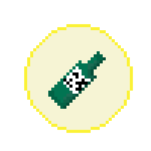

# 띵지런 (MJU_RUN)

> 프로그래밍 에러를 피해 달리고 O/X 퀴즈를 풀어 **졸업**하라 — 2D 횡스크롤 러닝 게임

2022-2학기 명지대학교 게임프로그래밍 팀 프로젝트(6조). Unity 기반 2D 러너 게임입니다.

<p>
  
  
  
  
  
</p>

---

## 게임 소개

장애물(`IndexError`, `NameError`, `TypeError`, `404`, `502` …)을 피해 달리며 **출석 아이템**을 모으고,
스테이지 끝 **O/X 퀴즈**를 풀어 명지대 융합소프트웨어학부 데이터테크놀로지 전공을 수료·졸업하는 것이 목표입니다.

| 항목 | 내용 |
|---|---|
| 장르 | 2D 횡스크롤 러닝 |
| 플랫폼 | PC (Unity) |
| 핵심 재미 | 프로그래밍에서 자주 보던 에러가 장애물로 등장, 공부한 내용을 퀴즈로 출제 |
| 클리어 조건 | 스테이지별 출석 아이템 5개 중 **4개 이상** 획득 + 퀴즈 정답 |

## 조작 방법

| 키 | 동작 |
|---|---|
| ▲ / Space | 점프 (2단 점프) |
| ▼ | 슬라이딩 |
| 퀴즈 구간 | 양 갈래길에서 O 또는 X 선택 |

## 아이템

| 아이템 | 효과 |
|---|---|
| 📖 아는 것이 힘 | 일시적으로 킥보드 탑승, 모든 장애물 회피 |
| ❤️ 회복 | 부딪혀 닳은 체력 회복 |
| 🍶 소주 | 디버프 — 일시적으로 점프·슬라이딩 불가 |

## 코드 구조 (`src/`)

Unity 패키지(`mjrun3.unitypackage`)에서 추출한 **팀 작성 C# 스크립트 20개** (약 900줄).

| 경로 | 역할 |
|---|---|
| `src/CollegeStudent/Demo/DemoCollegeStudentController.cs` | **플레이어 메인 컨트롤러** — 달리기·점프·슬라이드·킥보드·소주 디버프·출석·충돌·게임오버 (핵심 로직) |
| `src/CollegeStudent/Demo/GameDirector.cs` | 체력·출석 게이지 UI 관리 |
| `src/CollegeStudent/Demo/AttendanceController.cs` · `BookController.cs` · `SojuController.cs` · `PosionController.cs` | 아이템 획득·효과 처리 |
| `src/CollegeStudent/Demo/HurdleController.cs` | 장애물(에러) 동작 |
| `src/CollegeStudent/Demo/CameraDirector.cs` | 카메라 추적 |
| `src/Questions/QuestionDirectorController.cs` · `QuestionDirectorController2.cs` | O/X 퀴즈 출제·정답 판정·씬 전환 |
| `src/Start/` | 시작 화면 연출 및 스테이지 진입 (`startDirector`, `playerController`, `nextDirector`) |
| `src/Info/` · `src/Info2/` | 게임 설명 화면 |
| `src/Clear/ClearController.cs` | 클리어 화면 |
| `src/GameOver/` | 게임오버 화면 연출 (배경·교수·학생) |

> `src/`의 스크립트는 **열람·리뷰용**입니다. 실제 실행에는 아래처럼 전체 패키지를 임포트하세요.

## 실행 방법

1. Unity(2021.x 권장)에서 2D 프로젝트 생성
2. `Assets > Import Package > Custom Package…` → 저장소의 **`mjrun3.unitypackage`** 선택
3. `Assets/Scene`의 시작 씬을 열고 ▶ 실행

## 저장소 구성

```
Game_Programming/
├── src/                    # 팀 작성 C# 스크립트 (패키지에서 추출, 열람용)
├── mjrun3.unitypackage     # 게임 전체 (씬·프리팹·에셋 포함, 임포트용)
├── aseprite자료/           # 직접 제작한 픽셀아트 원본(.aseprite)·PNG
└── 최종발표.pdf            # 기획·레벨디자인·역할분담 발표자료
```

## 크레딧 · 출처

- 개발: 2022-2 명지대학교 게임프로그래밍 **6조** (상세 역할 분담은 `최종발표.pdf` 참고)
- 픽셀아트: 팀 직접 제작 (`aseprite자료/`)
- 캐릭터 에셋: Unity Asset Store — [Cute 2D College Student](https://assetstore.unity.com/packages/2d/characters/cute-2d-college-student-198684)
- 플레이어 컨트롤러는 위 에셋의 데모 스크립트를 팀이 확장·수정한 것입니다.

> ⚠️ **서드파티 에셋 안내.** `mjrun3.unitypackage`에는 위 Unity Asset Store 캐릭터 에셋과 BGM 음원이
> 포함돼 있습니다. 이들은 팀 저작물이 아니며, 재배포 가능 여부는 각 라이선스를 따릅니다.
> 재사용 시 원 출처에서 직접 받으시기 바랍니다.
